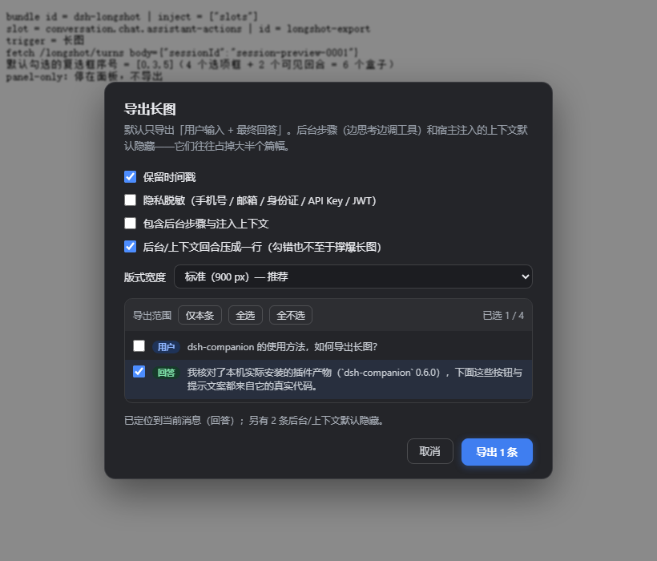

# dsh-longshot

Export **selected turns** of a DSH conversation as **one long PNG**.

- Entry point: a compact **“长图” (long image)** button in each assistant message's action row
  (`conversation.chat.assistant-actions`), not a separate top-bar button;
- Pick turns one by one; turns are classified as **user / answer / background step / injected context**,
  and the last two are hidden and excluded by default;
- Client-side tiled canvas rasterization — no `window.print()` dialog at all;
- No external dependencies, no CSS modules, no bundler: the whole browser half is one `lib/client.js`.

中文文档见 [README.md](README.md)。



## Why

The existing long-image implementation in `dsh-companion` does not run from its published artifacts:
its browser half ships without 7 `.module.css` files and as plain ESM instead of the
`window.__ModuleLoader__.load({ id, factory })` contract the host module system requires.
As a result the export button never appears (that repo's issue #1, still open).

This plugin re-implements the same pipeline in the minimal form the host accepts, and adds what the
original lacked: per-turn selection and background-turn detection.

## Features

| | |
|---|---|
| Output | one vertical PNG at 2× DPR (900 CSS px layout → 1800 px wide) |
| Layout width | 720 / 900 / 1080 CSS px |
| Height | tiled raster + streaming PNG encoder; product cap 200k CSS px (~176 A4 pages), truncation is reported |
| Turn selection | per-turn checkboxes, “this one only / select all / select none”, type badges and 2-line previews |
| Turn classification | background steps (assistant text + tool calls) and injected context (`<system-reminder>`, runtime context, time samples) are hidden and excluded by default |
| Compact rows | if selected anyway, those turns render as a single line (tool names, char count, one-line snippet) |
| Redaction | phone / email / ID card / bank card / IP / API key / JWT |
| Print dialog | none |
| Data | read-only, in-memory only, no network |

## Install

Requires DSH `@deepseek-ai/dsh` ≥ 0.2.1-rc.2 (verified on Engineer Workbench 2.0.18).

```bash
dsh plugin add <this-repo> --profile <profile>
```

Then add the package name to that profile's `package.json`:

```json
{ "dsh": { "profile": { "bundles": ["dsh-longshot"] } } }
```

and restart DSH. Offline alternative: symlink/junction the repo into
`<profile>/node_modules/dsh-longshot` and append the `insert` row from [`cordis.patch.yml`](cordis.patch.yml)
to `<profile>/cordis.patch.yml`, then restart.

## Usage

Click **“长图”** under any assistant message → pick turns (the message you clicked is pre-selected)
→ choose width / timestamps / redaction → **“导出 N 条”** → the PNG is downloaded directly.

Turns exceeding the 200k CSS px cap are truncated with an explicit notice.

## Develop

```bash
npm run build   # src/* -> lib/client.js
npm test        # host-half smoke test (37 assertions)
npm run check   # syntax check
```

`lib/client.js` is a build artifact and must be committed; CI verifies it matches `src/`.

## Privacy and compatibility

Read-only, no telemetry, images are produced locally. Redaction is off by default.
HTTP routes rely on the host's browser trust fence only — do not expose the deployment to a LAN.

Depends on three non-public APIs: `ctx.webServer.register`, `ctx.sessionQuery.readSession`'s
`{ session, events }` shape, and the `conversation.chat.assistant-actions` slot.
`GET /longshot/ping` reports the plugin version, which helps when reporting breakage.

## License

MIT. The raster engine is vendored from [`beijingwahw/dsh-companion`](https://github.com/beijingwahw/dsh-companion)
(MIT) — see [THIRD_PARTY_NOTICES.md](THIRD_PARTY_NOTICES.md).
