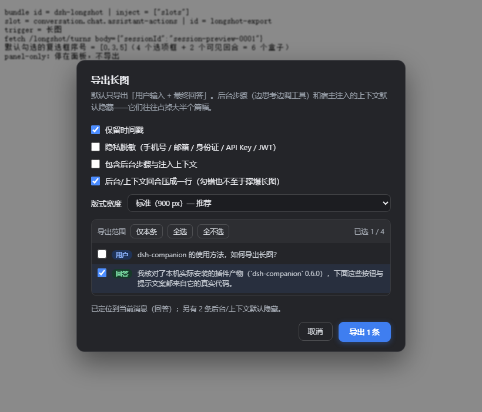
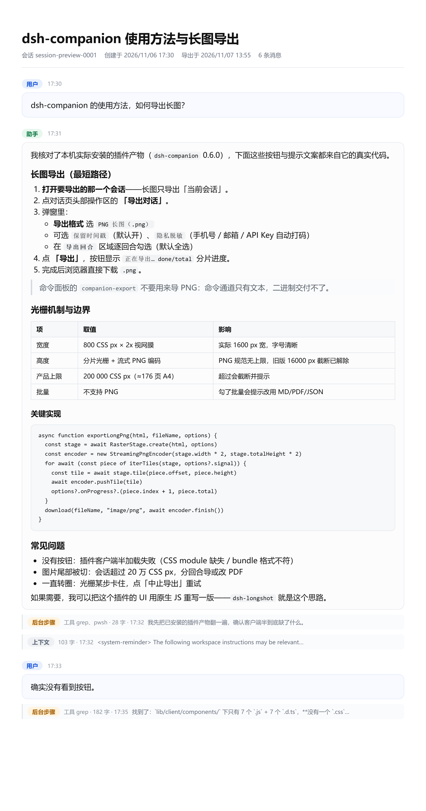

# dsh-longshot

把 **DSH 会话里选中的消息**导出成**一张纵向 PNG 长图**的插件。

- 入口就在每条助手消息自己的操作区里（和「复制 / 点赞 / 分享」同一行）的 **「长图」**，不额外占顶部按钮；
- 回合可逐条勾选，并自动区分 **用户 / 回答 / 后台步骤 / 注入上下文** —— 后两类默认隐藏且不导出；
- 客户端 canvas 分片光栅，全程没有 `window.print()` 对话框，PNG 规范本身无高度上限；
- 零外部依赖、零 CSS-module、零打包器：一个 `lib/client.js` 就是全部浏览器侧代码，方便审计。

[English](README.en.md) | 中文

| 面板 | 输出示例 |
|---|---|
|  |  |

## 为什么会有这个插件

DSH 生态里已有的长图实现（`dsh-companion` 的「PNG 长图」）在发布产物上跑不起来：客户端半缺失 7 个 `.module.css`，而且发布的是带 `import` 的裸 ESM，不是宿主模块系统要求的 `window.__ModuleLoader__.load({ id, factory })` 形式。结果就是「导出对话」按钮根本不出现（该仓库 issue #1，至今 open）。

这个插件用**符合宿主契约的最小实现**重做了那条链路，并补上了原实现没有的两件事：回合级选择、后台回合识别。

## 能力

| 项 | 取值 |
| --- | --- |
| 输出 | 单张纵向 PNG，2x 视网膜（版式宽 900 → 实际 1800 px 宽） |
| 版式宽度 | 720 / 900 / 1080 CSS px 可选 |
| 高度 | 分片光栅 + 流式 PNG 编码，PNG 规范无上限；产品上限 20 万 CSS px（≈176 页 A4），超出截断并提示 |
| 回合选择 | 面板里逐条勾选，带「仅本条 / 全选 / 全不选」；每条标出**类型徽章**与两行预览 |
| 回合分类 | 自动识别「后台步骤」（边思考边调工具的中间消息）与「注入上下文」（system-reminder / runtime context / 时间采样），这两类**默认隐藏且不导出** |
| 紧凑渲染 | 万一把后台/上下文勾进来，默认压成一行（含工具名、字数、一句摘要），不会撑爆长图 |
| 脱敏 | 手机号 / 邮箱 / 身份证 / 银行卡 / 地址 / API Key / JWT |
| 打印对话框 | 全程没有：canvas 光栅后直接下载 |
| 数据 | 只读；只在内存里转一圈，不写会话存储、不联网 |

## 回合类型（为什么默认看不到「后台」）

真实会话日志里，一个 turn 会拆成很多条 `assistant/message`：绝大多数只有 `reasoning` + `tool-call` 块（正文为空），只有最后一条才有 `text`。面板按下面的规则给每条可见回合分类：

| 徽章 | 判定 | 默认 |
| --- | --- | --- |
| **用户** | `user/message`，且不是宿主注入 | 勾选（点开的那条） |
| **回答** | `assistant/message`，正文非空、无工具调用 | 勾选（点开的那条） |
| **后台** | `assistant/message`，正文非空**且带 tool-call**（边想边调工具的那段） | 隐藏 |
| **上下文** | `user/message`，以 `<system-reminder>` / `Current runtime context.` / `Time sampled while preparing turn` 开头 | 隐藏 |

正文为空的纯工具步骤不会单独成行（否则长会话会有几百条空回合），它们的工具名会记在那条回合上。

面板底部勾上 **「包含后台步骤与注入上下文」** 才会显示这两类；勾上后「全选」= 当前可见的全部，且它们默认被**压成一行**（由「后台/上下文回合压成一行」开关控制）。

实测一条 6 轮会话：25 条可见回合里，10 条是注入上下文/后台步骤（其中 3 条注入就有 4578 字），默认导出能省掉一大半篇幅。

## 安装

要求：DSH `@deepseek-ai/dsh` **0.2.1-rc.2** 及以上（实测于 Engineer Workbench 2.0.18），Node ≥ 22.19（宿主自带）。

### 方式一：插件市场（尚未收录）

目前还没提交到任何市场索引，请用方式二或三。若你的 DSH 带 `dshmarket`，可以直接把它当普通 bundle 装：

```bash
dsh plugin add https://github.com/bernardguan/dsh-longshot --profile <profile>
```

### 方式二：命令行

```bash
# 用 GitHub 仓或本地目录都可以
dsh plugin add <this-repo> --profile <profile>
```

然后把包名加进该 profile 的 `package.json`：

```json
{
  "dsh": { "profile": { "bundles": ["dsh-longshot"] } }
}
```

重启 DSH。bundle 层会通过 `cordis.patch.yml` 自动插入 loader 行。

### 方式三：手工（离线 / 不想动 pnpm）

```powershell
$profile = "$env:USERPROFILE\.dsh\profiles\desktop"   # 换成你的 profile
# 1) 让 profile 能解析到包（目录联结，不需要联网）
New-Item -ItemType Junction -Path "$profile\node_modules\dsh-longshot" -Target "<path-to-this-repo>"

# 2) 在 profile 补丁层插入 loader 行（文件：$profile\cordis.patch.yml）
#    - insert:
#        - id: longshot
#          name: dsh-longshot

# 3) 重启
```

> loader 行只在**启动期**生效：改完补丁文件必须重启应用。客户端 bundle 本身支持热替换（HMR），但 Host 半的 ESM 缓存不会热更新。

## 卸载

```bash
dsh plugin remove dsh-longshot --profile <profile>   # 方式一/二
```

手工安装的：删掉 `cordis.patch.yml` 里那段 `insert`、删掉链接 `node_modules\dsh-longshot`，重启。

## 使用

任意**助手消息**下方的图标行里点 **「长图」**：

1. 面板加载当前会话的回合清单，默认只勾你点开的那条；
2. 需要更多就勾更多；「全选」指当前可见项（后台/上下文未显示时不参与）；
3. 需要连后台一起导，勾上「包含后台步骤与注入上下文」；
4. 选宽度 / 时间戳 / 脱敏，点 **「导出 N 条」**；
5. 浏览器直接下载 `<标题>-长图-选中N条-YYYYMMDD-HHmm.png`。

超过 20 万 CSS px 会截断并在状态栏提示；此时减少勾选或改用更窄的版式。

## 结构

```
lib/index.js     Host 半：注册 /longshot 前缀路由，读会话 → 分类 → 渲染自包含 HTML
lib/client.js    浏览器半（构建产物）：消息操作区按钮 + 面板（回合勾选）+ canvas 光栅
src/raster.js    光栅引擎（vendor 自 dsh-companion，MIT，见 THIRD_PARTY_NOTICES.md）
src/ui.js        按钮与面板（原生 DOM，无 CSS module，无 JSX）
scripts/build-client.mjs   把 src/* 内联成 __ModuleLoader__ 产物
scripts/preview.mjs        生成样例 HTML（人工看版式）
scripts/verify-browser.mjs 无桌面端跑真浏览器链路（生成 harness → Chrome 取证）
test/smoke.mjs   Host 半冒烟测试（37 条断言）
```

### 为什么不用打包器

DSH 的客户端插件 bundle 由宿主**原样下发**给浏览器，模块系统只认：

```js
window.__ModuleLoader__.load({ id: "dsh-longshot", factory: (require) => { ... } })
```

工厂里只能 `require` 基座模块（`react`、`react/jsx-runtime`、`@deepseek-ai/dsh-client-ui-*` 等），**不支持相对 import、不支持 CSS module**。所以这里把两个源文件拼进同一个闭包，样式用字符串 + 内联，天然满足契约，也没有一条只能在作者机器上跑的构建链。

## 开发

```bash
npm run build     # src/* → lib/client.js
npm test          # Host 半冒烟（37 条断言）
npm run check     # 语法检查
```

如果本机只有 DSH 桌面版、没有独立 Node，可以用 Electron 自带的 Node：

```powershell
$env:ELECTRON_RUN_AS_NODE = '1'
$node = '<你的安装目录>\Engineer Workbench.exe'
& $node scripts\build-client.mjs
& $node test\smoke.mjs
```

浏览器端自检（不需要启动 DSH，真 Chrome 跑 canvas 光栅并取出 PNG）：

```powershell
& $node scripts\preview.mjs tmp\preview.html 900
& $node scripts\verify-browser.mjs                    # 生成 tmp\harness.html
& <chrome> --headless=new --disable-gpu --user-data-dir=tmp\chrome-profile `
    --virtual-time-budget=60000 --dump-dom "file:///<abs>/tmp/harness.html" > tmp\dom.txt
& $node scripts\verify-browser.mjs decode tmp\dom.txt tmp\harness.png
```

改 `src/*.js` 后必须重新 `npm run build` 并提交 `lib/client.js`（CI 会检查两者是否一致）。

## 排障

- **按钮没出现**：先看 `%TEMP%\dsh-longshot.mounted`（诊断面包屑，含版本号与进程号；设 `DSH_LONGSHOT_NO_MARKER=1` 可关闭）——没有就是 Host 半没挂上（补丁行没插 / 没重启）；再看 设置 → 插件 → 插件列表 的同步错误。
- **面板里报 404 / 「没有这条接口」**：客户端已热更新、Host 半还是旧代码（改了 `lib/index.js` 必须重启应用）。
- **默认没勾中当前这条**：面板会退回全选并在状态栏说明——通常是流式输出还没落盘导致文本对不上。
- **点了报「读取会话失败」**：会话 id 传错，或该会话只有元数据没有消息事件。
- **图片被截断**：单条会话超过 20 万 CSS px，减少勾选或换更窄的版式。
- **下载被拦**：Electron 里一般不会；若在普通浏览器里用，需要允许该站点下载。

## 隐私与安全

- 只读：仅调用 `sessionQuery.readSession()`，不写任何会话数据。
- 图片在**浏览器本地**生成，不经过网络；无遥测、无追踪。
- 隐私脱敏默认**关闭**（你可能就想要原样），导出前请自行确认是否含敏感信息。
- 路由 `/longshot/render`、`/longshot/turns` 依赖宿主的浏览器信任栅栏（非 loopback 请求会被拒绝），**额外不再做鉴权**：请勿把 DSH 挂到局域网/公网后依赖本插件保护数据。

## 兼容性说明

本插件依赖三个非正式对外 API：

1. `ctx.webServer.register({ kind: 'prefix', path, handler })`
2. `ctx.sessionQuery.readSession(id)` 返回的 `{ session, events }` 形状（事件类型 `user/message` / `assistant/message`，内容块 `text` / `reasoning` / `tool-call`）
3. 槽位 `conversation.chat.assistant-actions`（list / session 作用域）与 `ctx.slots.register`

`/longshot/ping` 会回报插件版本，便于定位「装的是哪一份」。dsh 大版本升级后如失效，请开 issue 并附上 `/ping` 结果与 dsh 版本。

## 许可

[MIT](LICENSE)。浏览器侧光栅引擎来自 [`beijingwahw/dsh-companion`](https://github.com/beijingwahw/dsh-companion)（MIT），改动与版权声明见 [THIRD_PARTY_NOTICES.md](THIRD_PARTY_NOTICES.md)。
